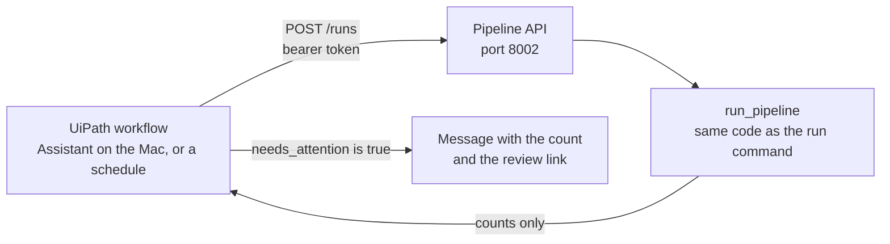
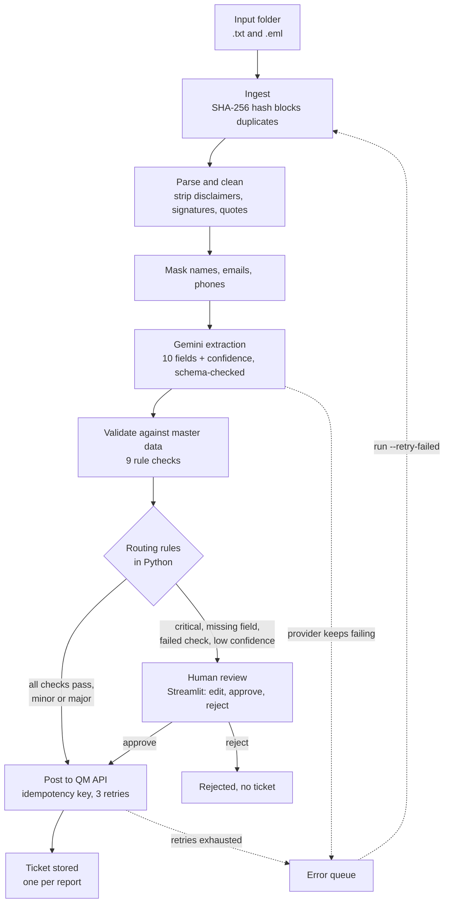

# Defect Report Automation

Reads unstructured quality reports from a switchgear factory (emails as `.txt` and `.eml`)
and turns them into validated quality tickets.

- An LLM extracts 10 fields from each report.
- Python checks the fields against master data and decides the route.
- A person approves anything uncertain, broken or critical.
- Approved tickets are posted to a QM API, exactly once.

The full spec is in [docs/PROJECT.md](docs/PROJECT.md). All data is synthetic: no real
orders, suppliers or people.

## Results

Measured on the 20 labelled reports with `python -m defect_automation eval`
(model `gemini-3.5-flash-lite`, prompt `extraction_v1`):

| Metric | Result | Target |
| --- | --- | --- |
| Field accuracy (9 scored fields × 20 reports) | 100% | 90% or better |
| Critical recall (critical reports that reached a person) | 4 of 4 | 100% |
| Must-review cases caught (critical, missing order, unknown part, two defects) | 9 of 9 | all |
| Auto-approved reports with a wrong field | 0 of 10 | 0 |
| Model cost per report | 0.0004 EUR | under 0.01 EUR |
| Median processing time per report | 1.4 s | under 30 s |

**Read these numbers with care.** The reports are synthetic. The same model family wrote
them from known facts, and a code check made sure every fact appears in the text. Real
shop-floor emails are messier, so real accuracy will be lower. With 20 reports, a perfect
score still leaves room for an error rate of a few percent. The numbers show that the
pipeline works end to end. They do not show how it performs on real data.

## Setup

Needs macOS and Python 3.11 or newer.

```bash
python3.12 -m venv .venv
source .venv/bin/activate
pip install -r requirements.txt
cp .env.example .env        # then add your Gemini API key and a review password
python -m defect_automation seed
```

Get a free Gemini key at <https://aistudio.google.com/apikey>. The `.env` file is ignored
by Git.

## Usage

Three terminals, each with the virtual env active:

```bash
python -m defect_automation qm-api    # 1: the mock QM API, port 8001
python -m defect_automation run       # 2: process data/reports/ from file to ticket
streamlit run streamlit_app.py        # 3: review screen, tickets and metrics, port 8501
```

`run` reads every report in the input folder. Each one ends as a posted ticket or as an
item in the review queue. Running it again is safe: nothing is processed or posted twice.
If the QM API is down, approved reports wait and post on the next run.

Other commands:

```bash
python -m defect_automation run --retry-failed   # put the error queue back in line first
python -m defect_automation eval                 # score the 20 labelled reports
python -m defect_automation eval --history       # compare all saved eval runs
python -m defect_automation ingest | extract | post   # single steps
python -m defect_automation api                  # pipeline API for UiPath, port 8002
pytest                                           # 111 unit and integration tests
```

To try your own report, drop a `.txt` or `.eml` file into `data/reports/` and run again.

## UiPath trigger

Added after the first build. A UiPath workflow starts a run and tells a person when
something needs them. UiPath only triggers and notifies. Extraction, validation, routing
and posting stay in the Python code.



Start it with `python -m defect_automation api`. Set `PIPELINE_API_TOKEN` in `.env` first:
without a token the API answers 503.

| Call | What it does |
| --- | --- |
| `GET /health` | Answers `{"status": "ok"}`. No token needed |
| `POST /runs` | Runs the pipeline once and returns the counts below |
| `GET /status` | Reports by status, ticket count, size of the review queue |

`POST /runs` answers with flat JSON, so a workflow can read it without mapping:

```json
{
  "run_id": "568b5a0d1e49",
  "new_reports": 0,
  "duplicates_skipped": 30,
  "auto_approved": 0,
  "sent_to_review": 0,
  "posted": 0,
  "failed": 0,
  "waiting_for_review": 7,
  "needs_attention": true,
  "stopped_by_cost_cap": false,
  "qm_unavailable": false,
  "review_url": "http://localhost:8501"
}
```

- The answer holds counts only: no report text and no names.
- One run at a time. A second call during a run gets 409.
- Calling it again is safe, for the same reason `run` is.
- The API listens on `127.0.0.1` only, so the workflow has to run on the same machine
  (UiPath Assistant for macOS). A cloud robot cannot reach it.

The workflow, built in UiPath Studio Web as an RPA Workflow and run on the local robot
(the "Local" target, not "Cloud"):

1. **Manual Trigger**.
2. **HTTP Request**: `POST http://127.0.0.1:8002/runs`, header
   `Authorization: Bearer <PIPELINE_API_TOKEN>`, no body.
3. **Log Message** with the response status code.
4. **Deserialize JSON** on the response text, for later steps that need single values.
5. **If** the response text contains `"needs_attention":true`: **Message Box** saying
   reports are waiting, with the review link.
6. **Else**: **Log Message** "Run finished, nothing to review".

## Architecture



Every step reads from and writes to one SQLite file, so a run that stops anywhere picks up
where it left off. The `reports.status` column is the work queue:

```
received -> parsed -> extracted -> validated -> approved -> posted
                |                            -> in_review -> approved | rejected
                -> failed (error queue, also reached when posting gives up)
```

The control flow lives in code, which keeps it testable. The LLM is one tool the code
calls, next to the parser, the validators and the QM API.

### Project layout

| Path | What it holds |
| --- | --- |
| `defect_automation/config.py` | All settings, read from the environment or `.env` |
| `defect_automation/domain.py` | Fixed vocabularies: defect types, severities, statuses |
| `defect_automation/schema.sql`, `db.py` | SQLite schema, connection, audit-log helper |
| `defect_automation/ingest.py` | Reads report files into the `reports` table |
| `defect_automation/parsing.py` | Splits `.txt`/`.eml` into headers and body, cleans the body |
| `defect_automation/masking.py` | Replaces names, emails and phone numbers with tokens |
| `defect_automation/schemas.py` | Pydantic models for the 10 fields and their confidence |
| `defect_automation/prompting.py`, `prompts/` | Versioned prompt files and the code that fills them |
| `defect_automation/llm.py` | The one interface every model call goes through, plus the answer cache |
| `defect_automation/extraction.py` | The extraction step: mask, call the model, check the schema, store |
| `defect_automation/cost.py` | Cost per call and the daily cost cap |
| `defect_automation/validation.py` | Rule checks against master data |
| `defect_automation/routing.py` | The routing rules: human review or auto-approve |
| `defect_automation/posting.py` | Builds the ticket and posts it with retries and an idempotency key |
| `defect_automation/pipeline.py` | Moves reports through the status flow |
| `defect_automation/api.py` | HTTP door to the pipeline, for an orchestrator such as UiPath |
| `defect_automation/review.py` | Review queue, review item, saving a decision |
| `defect_automation/metrics.py` | Numbers for the metrics page |
| `defect_automation/evaluation.py` | Scores the pipeline on the labelled reports |
| `defect_automation/logging_setup.py` | JSON logs with a run ID |
| `streamlit_app.py` | Review screen, tickets page and metrics page |
| `mock_qm/app.py` | The mock QM system (FastAPI), with built-in faults |
| `scripts/` | Synthetic data generators |
| `data/master/` | 50 orders, 80 parts, 15 suppliers, 12 stations |
| `data/reports/` | 30 synthetic reports (20 `.txt`, 10 `.eml`) |
| `data/eval/labels.json` | Correct answers for 20 of the reports |
| `data/eval/results/` | One JSON file per eval run, kept to compare prompts and models |
| `var/` | Local database, cache and logs. Ignored by Git |

### Data model

| Table | Purpose |
| --- | --- |
| `reports` | One row per file. `file_hash` is unique. `status` is the queue. Holds the only unmasked copy of the text |
| `extractions` | Every model answer with model, prompt version and cost |
| `validations` | One row per rule check, passed or failed |
| `reviews` | Human decisions and the fields they approved |
| `tickets` | The QM ticket ID. `report_id` is unique: one ticket per report |
| `audit_log` | Append-only trail: every input, model call, check, route, decision and posting attempt, with a run ID |
| `master_orders`, `master_parts`, `master_suppliers`, `master_stations` | Reference data |

## Design choices

### The LLM extracts, code decides

- **The model fills a schema and nothing else.** It gets one prompt with the field rules,
  the allowed values, 5 worked examples and the report. Validation, routing and posting
  are decided in Python.
- **Strict schema, one retry.** Gemini's JSON schema mode shapes the answer and Pydantic
  checks it again. A rejected answer is retried once with the error message. A second
  rejection sends the report to human review. A provider failure after 5 backed-off
  attempts sends it to the error queue.
- **Missing means null.** The prompt tells the model to return null with confidence 0
  instead of guessing. Report confidence is the lowest field confidence.
- **Model confidence is a weak signal.** The scores are the model's own estimate. In
  practice it returns nearly the same high numbers every time, and no report was routed to
  review on confidence alone. Routing therefore rests on the rule checks and the critical
  rule. The 0.85 threshold stays in place as a backstop.
- **Versioned prompts.** `prompts/extraction_v1.md` is the prompt. A change means a new
  file and a new `PROMPT_VERSION`. Every extraction stores its prompt version and model.
- **Worked examples are invented.** None of the 5 examples comes from the report set. The
  labelled reports were never used to write or tune the prompt.
- **One model interface.** Only `llm.py` imports a provider SDK. Changing the provider or
  model is a config change. The model is pinned to `gemini-3.5-flash-lite`; rerun the eval
  after changing it.

### Guardrails

- **Critical always goes to a person.** No setting turns this off. `posting.py` checks it
  again and refuses a critical report with no human approval on record.
- **Safety net for missed criticals.** The `critical_language` check looks for safety and
  stop-shipment wording. If the model rated such a report lower than critical, it goes to
  review. This costs a few extra reviews and protects the one metric that must be 100%.
- **Create only.** The agent can create tickets. The mock has no edit, close or delete
  endpoint and the client has no code for one.
- **Prompt injection.** Report text sits in a delimited block, the prompt says to treat it
  as data, and the delimiters are neutralised inside the report text.
- **Daily cost cap.** Every model call is logged with tokens and cost. Before each call,
  today's total is checked against `DAILY_COST_CAP_EUR` (default 1.00). At the cap the
  run stops calling the model and the remaining reports stay queued. The token prices in
  `config.py` are assumed values, since the free tier bills nothing. Set them from the
  current price list before using a paid key.

### Validation and routing

- **Nine checks per report:** required fields, order exists, part exists, supplier exists,
  supplier matches the part, station known, date plausible, single defect, critical
  language.
- **Routing is one pure function.** A report is auto-approved only if severity is minor or
  major, every required field is present with confidence of at least 0.85, and every check
  passes. Everything else goes to a person with the reasons listed.
- **Two defects in one email.** The first defect is extracted. A second part number in
  the text sends the report to review, so the second defect is not lost silently.

### Posting, idempotency and retries

| Method | Endpoint | Behaviour |
| --- | --- | --- |
| POST | `/api/v1/notifications` | Creates a ticket. Requires an `Idempotency-Key` header. The same key returns the same ticket (200 instead of 201). The same key with a different body is a 409 |
| GET | `/api/v1/notifications/{id}` | Returns one ticket |
| GET | `/api/v1/health` | Health check, free of faults |

Interactive docs are at <http://127.0.0.1:8001/docs> while the mock runs.

- **The mock fails on purpose.** 5% of calls answer 503, 5% take a second longer, and more
  than 60 calls a minute get a 429 with `Retry-After`. Half of the 503s happen after the
  ticket was saved, so the answer is lost while the ticket exists. All rates are settings.
- **Idempotency in three layers.** The key is `report-<file hash>`, so a retry, a rerun or
  a crash between the API answer and the local write all send the same key.
  `tickets.report_id` is unique. And only reports in status `approved` are posted.
- **Retries.** One call plus 3 retries with exponential backoff and jitter, on 503, 429
  and network errors. A 429 waits for `Retry-After`. Other 4xx answers are not retried.
  After the last retry the report goes to the error queue.
- **Restartable.** Each step selects reports by status and commits its result. No step
  runs twice for one report.

### Personal data and security

- **Masking before the model.** Names, emails and phone numbers become tokens such as
  `[PERSON_1]`. The model, the `extractions` table and the logs only ever see tokens.
- **Real names appear in two places:** the review screen, because the reviewer needs
  them, and the posted ticket. Both rebuild the name from the raw report at that moment.
  Masking is deterministic, so no token-to-name mapping is ever stored.
- **Masking limit.** Names are found in From/To/Cc lines (also inside forwarded blocks)
  and after sign-offs. A name that appears only in running text is not caught. A real
  deployment would add a named-entity model here.
- **Secrets** live in `.env`, loaded through pydantic-settings and kept out of Git.
- **Review login.** The app asks for a name and the shared password from
  `REVIEW_PASSWORD`, and refuses to open without one. This is a single shared password,
  not user accounts. A real deployment would use company single sign-on.
- **Service account.** The pipeline calls the QM API with its own bearer token
  (`QM_API_TOKEN`). The default value only suits the local mock.
- **Demo switch.** `REVIEW_LOGIN_OPEN=true` in `.env` makes the login accept any
  password, and the login screen says so. It is off by default and is only for a local
  demo with fake data.
- **Every decision is confirmed.** Approve and Reject each open a popup that asks
  "Are you sure?". Nothing is saved or posted until the reviewer says yes.
- **Append-only history.** Decisions and audit events are only ever added. Nothing in the
  code updates or deletes them.
- **Works council note.** The metrics page counts reports and defects. It shows no
  per-person speed or volume, and the code computes none. Reviewer names appear only in
  the audit trail. A German site would need works council sign-off before tracking
  individuals.
- **Model provider.** Only masked text is sent to Gemini, and all data here is fake. A
  real deployment needs a company-approved model or a private endpoint.

### Synthetic data

- **Labels come before text.** Each report is written by Gemini from one seeded master
  data record, so the correct answer exists before the email does. Code then checks that
  the order, part, supplier, date, reporter and quantity appear in the text, and
  regenerates the email if not.
- **Messy on purpose.** The 30 reports include missing order numbers, part numbers that
  are not in master data, two defects in one email, forwarded chains and long signatures.
  Four are critical, and all four are in the labelled set.
- **The model writes words, code builds the layout.** The generator asks for a greeting,
  paragraphs and closing lines as separate fields, then assembles headers, line breaks
  and forwarded-message blocks itself.
- **Regenerating** (optional, the data set is in the repo):
  `python -m scripts.generate_master_data`, then
  `python -m scripts.generate_reports --force` (30 model calls). New wording means new
  file hashes, so reseed and rerun afterwards.

## Testing

| Kind | What it covers |
| --- | --- |
| Unit | Parsing, masking, schema, validation rules, routing rules, cost cap, cache, scoring |
| Integration | Folder to routed report, and approved report to posted ticket against the mock API in-process |
| Failure | 503s, lost responses, rate limits, timeouts, malformed model answers, a crash between steps |
| Idempotency | Same folder twice, same report posted twice, a crash after the API answered |
| API | Token check, run counts, repeat run, no report text in the answer |
| UI | Login, review, edit, approve and the metrics page, driven by Streamlit's test driver |
| AI evaluation | `python -m defect_automation eval` on the 20 labelled reports |

111 tests, 85% line coverage (`pytest --cov=defect_automation --cov=mock_qm`). The parts
without tests are the command-line wrapper and the live Gemini client.

How the eval scores:

- A field is correct on an exact match. Supplier and reporter ignore case, spacing and
  punctuation. A value invented for a field the report does not contain counts as wrong.
- `defect_description` is free text and is not scored.
- For a two-defect email the label is the first defect. For a part number that is not in
  master data the label is the number as written.
- Critical recall counts critical reports that reached a person, by any rule.

## Known limits

- Synthetic data only, and a small evaluation set. See the note under Results.
- Model confidence does not separate right from wrong answers. See Design choices.
- Name masking misses names that appear only in running text.
- One report becomes one ticket. A second defect in the same email has to be entered by
  the reviewer.
- The review login is one shared password.
- One run processes reports one after another. That is enough for 500 a day at about
  1.5 seconds each, but it has not been load-tested.
- Reports are assumed to be UTF-8 text. Attachments are ignored.

## Phase 2

Not in this build: German reports, PDFs and scanned notes, a live inbox watcher and IMAP
reader, model comparison and an OpenAI fallback, bill of materials checks, the morning
summary email, a Power BI dashboard, a real SAP connection, PostgreSQL, Docker Compose, CI,
the UiPath bot that fills the legacy web form, duplicate-defect linking and the 90-day
retention purge. (A small pipeline API and a UiPath trigger workflow were added after the
first build, see UiPath trigger.)
# defect-report-automation
